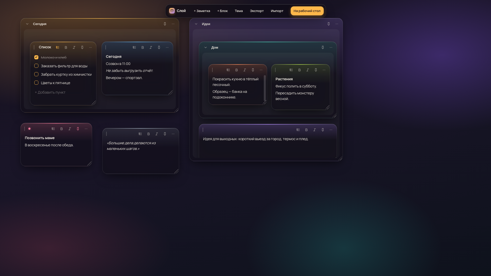

# Слой

Красивые вложенные заметки прямо на рабочем столе Windows.

Карточки живут *на* рабочем столе: вы видите их над обоями, а обычные окна открываются поверх. Наведите курсор на карточку — её можно сразу писать, таскать и менять размер. Пустые места кликаются насквозь, как обычный рабочий стол. Обои программа не меняет и не затемняет: рисуются только сами карточки.



## Возможности

- Заметки и **блоки**, внутри которых снова блоки и заметки — вложенность любая.
- Несколько мониторов: на каждом своя доска, карточку можно перетащить на соседний экран. Новая заметка (`Ctrl+N`, двойной щелчок, кнопки панели) появляется на том мониторе, где курсор.
- Если монитор отключили, его карточки временно переезжают на основной и возвращаются, когда экран снова появляется.
- Свободное перетаскивание, бросьте карточку в блок, чтобы вложить, вытащите наружу, чтобы вынуть.
- Двойной щелчок по пустому месту создаёт заметку; правая кнопка открывает меню.
- Изменение размера, сворачивание и переименование блоков.
- Многострочный текст, **жирный** и *курсив*, списки дел, цвет и закрепление.
- Стеклянный интерфейс, мягкие тени, пружинные анимации, тёмная и светлая тема.
- Автосохранение в `%APPDATA%\desktop-notes\board.json`, экспорт и импорт резервной копии.
- Иконка в трее: режим правки, автозапуск вместе с Windows, выход.
- Интерфейс на русском, шрифт с нормальной кириллицей (Manrope).

При запуске открывается режим правки с панелью сверху. Кнопка **На рабочий стол** прячет панель за окна; на каждом мониторе остаётся небольшая кнопка **Редактировать**, на неё всегда можно нажать. Тот же переключатель — в трее у часов (одиночный или двойной щелчок по значку).

## Горячие клавиши

| Клавиши | Действие |
| --- | --- |
| `Ctrl+Alt+N` | Режим правки / вернуть на рабочий стол |
| `Ctrl+Alt+Shift+N` | То же, если `Ctrl+Alt+N` занята другой программой |
| `Ctrl+N` | Новая заметка (на мониторе под курсором) |
| `Ctrl+Shift+N` | Новый блок (на мониторе под курсором) |
| `Ctrl+Z` / `Ctrl+Y` | Отменить / повторить |
| `Ctrl+B` / `Ctrl+I` | Жирный / курсив |
| `Ctrl+S` | Сохранить сразу (обычно сохраняется само) |
| `Ctrl+E` | Экспорт копии |
| `Delete` | Удалить выбранную карточку |
| `F2` | Переименовать блок |
| `Esc` | Снять выделение или выйти из правки |

## Установка

Скачайте свежий релиз и запустите файл — установка не нужна.

- **`Sloy-1.0.2-portable-win-x64.exe`** — один файл, можно положить куда удобно и запустить.
- **`Sloy-1.0.2-win-x64.zip`** — распакуйте и запустите `Sloy.exe`.

Windows может показать предупреждение SmartScreen у неизвестного издателя: «Подробнее» → «Выполнить в любом случае».

Требования: Windows 10 или 11, 64-разрядная система.

При первом запуске на доске уже будет небольшой пример. Нажмите **На рабочий стол** или `Ctrl+Alt+N`, чтобы карточки ушли за окна. Если заметки видно, но они не нажимаются, откройте **Редактировать** на плавающей кнопке или через значок в трее.

Данные хранятся только локально: `%APPDATA%\desktop-notes\board.json`. В коде нет сетевых запросов и секретов. Старые доски версии 1.0.x подхватываются сами.

## Сборка из исходников

```bash
npm install
npm test
npm start          # запуск у себя
npm run build:win  # Windows x64: portable .exe и zip
```

Сборку Windows можно сделать и с Linux: `electron-builder` скачает win32-бинарники сам. Для portable-установщика на Linux иногда нужен Wine.

Снимок демо-доски:

```bash
DESKTOP_NOTES_SCREENSHOT=./assets/screenshot.png npm run screenshot
```

## Как это устроено

Приложение написано на Electron. На каждом мониторе — своё прозрачное окно без рамки по рабочей области (не закрывает панель задач). Фон окна полностью прозрачный, обои Windows не меняются и не перекрываются заливкой, размытием или затемнением: видны только карточки и панели. В режиме стола окно стоит внизу z-порядка, *не* встраиваясь в слой `WorkerW`. Курсор над карточкой снимает «клик навылет», над пустым местом — возвращает его. Карточку, вытащенную на соседний монитор, подхватывает окно того экрана. Глобальная комбинация `Ctrl+Alt+N` (или `Ctrl+Alt+Shift+N`) поднимает доски для правки и опускает обратно.

## Лицензия

Код — [MIT](LICENSE). Шрифт Manrope — [SIL Open Font License](assets/fonts/OFL.txt).
